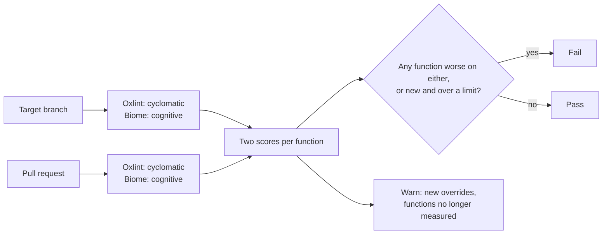

# Cyclomatic and cognitive complexity, explained

**A runnable guide to measuring how complicated your TypeScript and JavaScript
functions are, and stopping them getting worse, from your first `if` to a CI gate
for coding agents.**

Code rarely becomes hard to work with in one go. It happens one small, reasonable
change at a time. Each new `if` looks harmless in review. A year later one function
has two dozen ways through it, nobody can hold all of them in their head, and every
change risks breaking a case nobody remembered to test.

You can measure that drift. Two numbers do most of the work:

- **Cyclomatic complexity** counts the separate paths through a function. It tells
  you how many tests you need to try every path.
- **Cognitive complexity** scores how hard a function is to read, and it climbs
  fastest when code nests `if` inside `if` inside `if`.

This guide teaches both from scratch, then shows how to use them as a check that
runs on every code change, on a codebase that already has complicated code in it,
without stopping work to clean everything up first. Every number on the page comes
from code in this repo that you can run yourself.

## Why this matters: a change that looked fine

A team keeps its payment logic in a function called `processPayment`. It decides
what happens to a payment (refund, review, approve) by asking a series of yes/no
questions: is the customer a VIP, is it international, is it flagged for fraud.

A developer opens a **pull request** (a proposed change, reviewed before it joins
the main code) to add express delivery. It adds one line,
`if (payment.express) …`, in five places inside `processPayment`. Each line reads
fine on its own. The reviewer approves it.

The team also runs **CI** (continuous integration: a server that checks every pull
request automatically) with a **linter** (a tool that reads code and reports
problems) and a complexity rule switched on. CI passes.

Yet `processPayment` went from **19 paths to 24**, and its reading cost went from
**28 to 38**. Five more cases now need tests, and the function got noticeably
harder to follow.

CI missed it because of how the team adopted the rule. Their old code already had
functions over the limit, so they recorded those existing failures as accepted
(**bulk suppressions**). From then on, the linter only checked whether the *number*
of over-limit functions in each file went up. `processPayment` was already over
the limit, so it could get worse forever without changing the count.

This repo contains that exact pull request, plus a small tool, a **ratchet**, that
catches it. A ratchet compares every function's scores with the same function on
the main branch. A function may get better or stay the same. It may not get worse.

| Check | What it compares | Result on the express-delivery PR |
|-------|------------------|-----------------------------------|
| Oxlint bulk suppressions | How many functions per file are over the limit | **Pass** for `payments.ts` |
| Complexity ratchet (this repo) | Each function's two scores, before and after | **Fail**: `processPayment` got worse on both |

## What you will learn

1. **What the two scores count** (Part 1): a table of every JavaScript construct
   and what it costs, and how to count a function by hand.
2. **Why you need both scores** (next section): a real change each one misses on
   its own.
3. **How to gate an existing codebase** (Part 2): why "count the failures" misses
   regressions, and how the ratchet works.
4. **When the score is wrong** (Part 3): functions that score high but read fine,
   and how to override the linter without hiding real problems.
5. **How to fix a function that is too complex** (Part 4): six refactoring
   techniques, beginner to advanced, each with before/after scores and a test
   proving the behaviour did not change.
6. **How the check gets gamed** (Part 5): three tricks that make the numbers look
   better while the code gets worse, and what catches them.
7. **How to set it all up** (Part 6): install, configure, CI, and hooks that make
   AI coding agents follow the same rules.

New to the subject? Read Part 1 and "Why you need both", then skip to Part 4. Setting
this up for a team? Parts 2, 3, 5 and 6 are for you.

## Words you will meet

| Term | Meaning |
|------|---------|
| Function | A named block of code, such as `function processPayment(...) { ... }` |
| Branch / path | A route through a function. Every `if` creates a fork: one path where the condition is true, one where it is false |
| Linter | A tool that reads code without running it and reports problems. This repo uses [Oxlint](https://oxc.rs/docs/guide/usage/linter) and [Biome](https://biomejs.dev/) |
| Rule | One check a linter runs, such as "no function over complexity 10" |
| Threshold | The limit a rule enforces: 10 for cyclomatic and 15 for cognitive in this guide |
| Pull request (PR) | A proposed change, reviewed before it merges into the main branch |
| Target branch | The branch a pull request merges into, usually `main` |
| CI | Continuous integration: a server that runs checks on every pull request and blocks it if one fails |
| Quality gate | A check in CI that must pass before code can merge |
| Bulk suppressions | A file listing the rule failures that existed when you turned a rule on, so the linter only fails on new ones |
| Ratchet | A gate that allows a score to improve or stay the same, never to get worse |
| Regression | A change that makes something worse. Here: a function's score went up |
| False positive | A rule failure on code that is fine as written |
| Override | A comment that switches a rule off for one function, such as `// oxlint-disable-next-line complexity` |
| Refactor | Changing how code is written without changing what it does |
| Coding agent | An AI tool that writes and edits code, such as Claude Code |
| Hook | A script a coding agent runs automatically, for example after every file edit |

## Run the demos

You need [Node.js 24 or newer](https://nodejs.org/) and
[pnpm](https://pnpm.io/installation). If your Node came with Corepack,
`corepack enable` turns pnpm on. Then:

```bash
git clone https://github.com/jagreehal/cyclomatic-and-cognitive-complexity-explained.git
cd cyclomatic-and-cognitive-complexity-explained
pnpm install               # installs Oxlint, Biome and the ratchet's other dependencies
pnpm examples              # every measurement on this page
pnpm demo:oxlint-baseline  # bulk suppressions pass the express-delivery PR
pnpm demo:ratchet-fail     # the ratchet fails it
```

No accounts and no network calls after install. To use the ratchet in your own
project, skip to [Part 6](#part-6-the-full-setup).

---

## Part 1: What a complexity score counts

### Cyclomatic complexity: count the decisions

Thomas McCabe defined cyclomatic complexity in 1976. The rule you need fits in a
sentence: **start at 1, then add 1 for every point where the code can go two ways.**

Count one by hand. This is `createOrder` from `fixtures/base/payments.ts`:

```ts
export function createOrder(itemCount: number, member: boolean): string {
  if (itemCount <= 0) return 'empty';                 // +1
  if (member && itemCount > 10) return 'member-bulk'; // +1 for the if, +1 for &&
  if (itemCount > 10) return 'bulk';                  // +1
  return 'ok';
}
```

1 + 4 = **5**. Oxlint agrees.

The `&&` counts because `member && itemCount > 10` hides a second decision: when
`member` is false, JavaScript never evaluates the right-hand side. That is a
separate path through the function.

The number has a concrete meaning. A score of 5 means five *linearly independent*
paths, and basis path testing needs one test per path to walk all of them. At 24,
`processPayment` needs 24. Branch coverage needs fewer, which is one reason
[100% branch coverage can still miss faults](https://github.com/jagreehal/100-percent-test-coverage-is-false-hope).

### What costs a point

`examples/16-what-counts/code.ts` has one tiny function per construct. Every
number below comes from `pnpm examples`:

| Construct | Example | Modified | Classic | Cognitive |
|-----------|---------|---------:|--------:|----------:|
| Straight-line code | `return a + b` | 1 | 1 | ≤1 |
| `if` | `if (a) return 1` | 2 | 2 | ≤1 |
| `if` / `else` | `if (a) {…} else {…}` | 2 | 2 | 2 |
| `else if` | `if (a) … else if (b) …` | 3 | 3 | 2 |
| `&&` or `\|\|` | `a && b` | 2 | 2 | ≤1 |
| A chain of four | `a && b && c && d` | 4 | 4 | ≤1 |
| `??` | `a ?? 0` | 2 | 2 | ≤1 |
| Two `?.` | `a?.b?.c` | 3 | 3 | ≤1 |
| Ternary | `a ? 1 : 0` | 2 | 2 | ≤1 |
| Default parameter | `function f(a = 1)` | 2 | 2 | ≤1 |
| Logical assignment | `o.a ??= 1` | 2 | 2 | ≤1 |
| `for` / `while` | `for (const v of values)` | 2 | 2 | ≤1 |
| `catch` | `try {…} catch {…}` | 2 | 2 | ≤1 |
| `finally` | `try {…} finally {…}` | 1 | 1 | ≤1 |
| `switch` with 4 cases | `switch (n) { case 1: … }` | 2 | 5 | ≤1 |
| Branch inside a callback | `values.map(v => v > 0 ? v : 0)` | 1 | 1 | ≤1 |

Biome only reports cognitive scores above 1, so **≤1** means 0 or 1.

Three rows surprise people:

- **Default parameters and `?.` cost a point each.** The metric sees
  `a = 1` as `a === undefined ? 1 : a`. Part 3 shows where that produces a false
  positive.
- **A callback is its own function.** The ternary inside `.map(...)` scores on
  the arrow function, and `callbackWithBranch` stays at 1. Keep that in mind when
  someone's refactor "lowers" a score by moving branches into callbacks.
- **`switch` costs 2 or 5 depending on the variant**, covered next.

### Classic versus modified

*Classic* cyclomatic complexity adds 1 per `case`. *Modified* adds 1 for the
whole `switch`. A `switch` over a union type is one decision ("which kind is
this?") with many answers, so modified is the better fit for TypeScript code that
uses discriminated unions:

| Function | What it does | Modified | Classic |
|----------|--------------|---------:|--------:|
| `statusLabelModified` | `switch` over 5 statuses | 2 | 6 |
| `statusLabelIfElse` | Same 5 statuses as `if` statements | 6 | 6 |
| `describePaymentError` | `switch` over 5 error types | 3 | 7 |
| `describePaymentErrorIfs` | Same errors as `if` statements | 7 | 7 |

Under classic, the `switch` and the `if` ladder cost the same, so the metric gives
you no reason to prefer the clearer one. Under modified, the `switch` wins. This
repo uses modified everywhere.

### Cognitive complexity: count what the reader holds in their head

Cyclomatic complexity counts paths. It ignores how you arrange them. These two
functions from `examples/04-deep-nesting` both score 5:

```ts
export function scoreShipment(opts: Shipment): number {
  let score = 0;
  if (opts.domestic) {
    if (opts.express) {
      if (opts.fragile) {
        if (opts.insured) {
          score = 4;
        } else {
          score = 3;
        }
      } else {
        score = 2;
      }
    } else {
      score = 1;
    }
  }
  return score;
}
```

```ts
export function scoreShipmentFlat(opts: Shipment): number {
  if (!opts.domestic) return 0;
  if (!opts.express) return 1;
  if (!opts.fragile) return 2;
  if (!opts.insured) return 3;
  return 4;
}
```

You can read the second one in a few seconds. The first makes you track four
levels of "which `if` am I inside?".

G. Ann Campbell's *cognitive complexity* (SonarSource, 2017) measures that.
It adds a point per break in linear flow, plus an extra point for every level of
nesting the break sits inside. It also skips shorthand that does not slow a
reader down: `?.`, `??`, and a run of the same boolean operator count once or not
at all.

| Function | Cyclomatic (modified) | Cognitive |
|----------|----------------------:|----------:|
| `scoreShipment` (nested) | 5 | **13** |
| `scoreShipmentFlat` (guard clauses) | 5 | **4** |
| `canEditNested` | 5 | 7 |
| `canEditGuards` | 4 | 3 |
| `tierNested` (nested ternaries) | 4 | 5 |
| `tierFlat` (if ladder) | 4 | 3 |
| `eligibleAnd` (`a && b && c && d`) | 4 | ≤1 |
| `cityLabel` (`?.` and a guard) | 3 | ≤1 |

The two metrics answer different questions:

- **Cyclomatic**: how many tests do I need to walk every path?
- **Cognitive**: how hard is this to read?

Where they disagree, look closer. Most false positives in Part 3 sit in exactly
that gap: high cyclomatic, cognitive near zero.

The ratchet in this repo enforces both. Oxlint supplies the cyclomatic score and
[Biome](https://biomejs.dev/linter/rules/no-excessive-cognitive-complexity/)
supplies the cognitive one, because Oxlint does not compute cognitive complexity.

### The full catalogue

| Example | Function | Modified | Classic | Cognitive | Lesson |
|---------|----------|---------:|--------:|----------:|--------|
| `01-nested-vs-flat` | `nested` | 4 | 4 | 6 | Nesting costs readers, not paths |
| `01-nested-vs-flat` | `flat` | 4 | 4 | 3 | Same paths, guard clauses |
| `02-modified-switch` | `statusLabelModified` | 2 | 6 | ≤1 | `switch` is one decision under modified |
| `02-modified-switch` | `statusLabelIfElse` | 6 | 6 | 5 | The same mapping as `if`s |
| `03-early-returns` | `canEditNested` | 5 | 5 | 7 | Nested permission checks |
| `03-early-returns` | `canEditGuards` | 4 | 4 | 3 | Guard clauses |
| `04-deep-nesting` | `scoreShipment` | 5 | 5 | 13 | Four levels deep |
| `04-deep-nesting` | `scoreShipmentFlat` | 5 | 5 | 4 | Same logic, flat |
| `05-boolean-chains` | `eligibleAnd` | 4 | 4 | ≤1 | Each `&&` is a path |
| `05-boolean-chains` | `eligibleOr` | 5 | 5 | 2 | `\|\|` inside a guard |
| `05-boolean-chains` | `eligibleMixed` | 4 | 4 | 3 | Mixed operators cost readers more |
| `05-boolean-chains` | `eligibleNestedIf` | 5 | 5 | 6 | The same as nested `if`s |
| `06-exhaustive-error-switch` | `describePaymentError` | 3 | 7 | 3 | Discriminated union `switch` |
| `06-exhaustive-error-switch` | `describePaymentErrorIfs` | 7 | 7 | 7 | The same errors as `if`s |
| `07-class-methods` | `quote` | 7 | 7 | 10 | Methods count like functions |
| `07-class-methods` | `simpleFee` | 3 | 3 | 2 | A small method |
| `13-loops-and-catch` | `sumPositive` | 3 | 3 | 3 | Loop with an `if` |
| `13-loops-and-catch` | `parseNumbers` | 4 | 4 | 5 | Loop with `try`/`catch` |
| `13-loops-and-catch` | `findFirstMatch` | 6 | 6 | 9 | Ternaries inside a loop |
| `14-ternaries` | `tierNested` | 4 | 4 | 5 | Nested ternaries |
| `14-ternaries` | `tierFlat` | 4 | 4 | 3 | The same tiers as `if`s |
| `15-optional-chaining` | `cityLabel` | 3 | 3 | ≤1 | `?.` adds paths |
| `15-optional-chaining` | `marketingEligible` | 4 | 4 | ≤1 | `?.` with `&&` |

---

## Why you need both

Each metric misses a regression the other catches. Both of these are runnable
ratchet scenarios in `examples/`.

### A gate on cyclomatic alone misses nesting

`examples/24-ratchet-nesting` rewrites a flat function as nested `if`s. Same
inputs, same answers, same paths:

```ts
// base: guard clauses                     // head: the same logic, nested
export function shippingTier(s) {         export function shippingTier(s) {
  if (!s.domestic) return 0;                let tier = 0;
  if (!s.express) return 1;                 if (s.domestic) {
  if (!s.fragile) return 2;                   if (s.express) {
  if (!s.insured) return 3;                     if (s.fragile) {
  if (!s.signature) return 4;                     if (s.insured) {
  return 5;                                         if (s.signature) {
}                                                     tier = 5;
                                                    } else { tier = 4; }
                                                  } else { tier = 3; }
                                                } else { tier = 2; }
                                              } else { tier = 1; }
                                            }
                                            return tier;
                                          }
```

| Metric | Before | After | Verdict alone |
|--------|-------:|------:|---------------|
| Cyclomatic | 6 | 6 | Pass: no new paths |
| Cognitive | 5 | **19** | **Fail**: new and over 15 |

Coding agents produce this shape often: each new condition goes one level
deeper than the last. A cyclomatic gate approves every one of those PRs.

### A gate on cognitive alone misses new paths

`examples/08-ratchet-worsen` adds an `employee` flag to `applyDiscount`, as a flat
list of `if`s:

| Metric | Before | After | Verdict alone |
|--------|-------:|------:|---------------|
| Cyclomatic | 7 | **16** | **Fail**: crossed 10 |
| Cognitive | 6 | 14 | Pass: still under 15 |

The function still reads top to bottom, so cognitive stays under its limit. It
also has nine more paths, and nine more cases somebody has to test. A cognitive
gate approves it.

### What each metric is for

| | Cyclomatic | Cognitive |
|---|---|---|
| Question it answers | How many tests do I need to cover every path? | How hard is this to read and change? |
| Grows with | Every decision: `if`, `&&`, `?.`, `??`, defaults, `case` (classic) | Breaks in flow, weighted by nesting depth |
| Ignores | Nesting | `?.`, `??`, defaults, runs of the same operator |
| Typical false positive | Option defaults, `?.` chains (Part 3) | Rare. Flat checklists stay below 15 |
| Default threshold here | 10 | 15 |
| Tool | Oxlint `complexity` (`variant: "modified"`) | Biome `noExcessiveCognitiveComplexity` |

Readability is the property you feel every day, so if you only look at one
number, look at cognitive. Gate on both: cognitive keeps the code readable, and
cyclomatic keeps the test effort honest.

---

## Part 2: Gating a codebase that already has complex code

You turn on `complexity` with a maximum of 10, run the linter, and get 400
errors. You cannot fix 400 functions before lunch, and you cannot leave the rule
off either.

### The usual answer: bulk suppressions

Oxlint and ESLint both ship *bulk suppressions*. You record today's violations in
a file, commit it, and the linter only fails on violations beyond that record.

```json
// oxlint.fixtures.json
{
  "rules": {
    "complexity": ["error", { "max": 10, "variant": "modified" }]
  }
}
```

```bash
oxlint --suppress-all      # writes oxlint-suppressions.json
```

```json
{
  "payments.ts": {
    "complexity": { "count": 2 }
  }
}
```

Commit that file and run Oxlint as normal in CI. When you fix a violation,
`oxlint --prune-suppressions` lowers the count.

Look at what the file records: **a count per file and rule**. `payments.ts` may
have two complexity violations. It says nothing about which functions they are or
how bad they are.

### One regression, start to finish

**Step 1. The target branch.** `fixtures/base/payments.ts` has two functions over
10, so the suppressions file records a count of 2:

| Function | Modified | Over 10? |
|----------|---------:|----------|
| `processPayment` | 19 | yes |
| `validateCustomer` | 12 | yes |
| `createOrder` | 5 | no |

**Step 2. The pull request.** `fixtures/head-fail/payments.ts` adds express
delivery. The `processPayment` part of the diff:

```diff
   if (payment.flagged) {
     if (payment.vip) return 'flagged-vip-review';
     if (payment.international) return 'flagged-intl-review';
+    if (payment.express) return 'flagged-express-review';
     return 'flagged-review';
   }
   if (payment.vip) {
     if (payment.refund) {
       if (payment.amount > 1000) return 'vip-refund-large';
+      if (payment.express) return 'vip-refund-express';
       return 'vip-refund';
     }
     if (payment.international) return 'vip-intl';
+    if (payment.express) return 'vip-express';
     if (payment.amount > 1000) return 'vip-large';
     return 'vip';
   }
   if (payment.refund) {
     if (payment.international) return 'refund-intl';
+    if (payment.express) return 'refund-express';
     if (payment.amount > 500) return 'refund-large';
     return 'refund';
   }
   ...
+  if (payment.express) return 'express';
```

The same PR adds a `risk` check to `validateCustomer` and two tiers to
`createOrder`.

**Step 3. What the suppressions see.**

| Function | Before | After | Over 10? |
|----------|-------:|------:|----------|
| `processPayment` | 19 | 24 | yes, as before |
| `validateCustomer` | 12 | 13 | yes, as before |
| `createOrder` | 5 | 8 | no |

Two violations before, two after. The count matches the file, so Oxlint exits 0:

```bash
pnpm demo:oxlint-baseline
# demo:oxlint-baseline passed: bulk suppressions still green after processPayment got worse.
```

`processPayment` could reach 40 and the result would not change. A count-based
gate fails on one thing: a *new* violation. The PR's new file `refunds.ts` has
one (`createRefund` at 14), so Oxlint does flag that file. The two functions that
got worse pass.

**Step 4. The cost.** Five more paths means five more tests to cover them.
Cognitive complexity went from 28 to 38, double the cyclomatic rise, because each
new `if` sits one or two levels deep. The reviewer saw six short lines.

**Step 5. The gate that catches it.** Compare each function's scores with its
scores on the target branch:

```bash
pnpm demo:ratchet-fail
```

```text
Complexity regressions detected:

payments.ts
  processPayment
    cyclomatic: 19 → 24 (+5)
    cognitive: 28 → 38 (+10)
  validateCustomer
    cyclomatic: 12 → 13 (+1)

refunds.ts
  createRefund (new function)
    cyclomatic: 14 (maximum for new code: 10)
    cognitive: 18 (maximum for new code: 15)

Quality gate failed.
```

`createOrder` went from 5 to 8 cyclomatic and 4 to 7 cognitive, and passed. Both
are still under their thresholds. `validateCustomer`'s cognitive score went from
14 to 15, which is allowed: it was under 15 and rose to the limit.

### The ratchet's four rules

The same rules apply to each metric separately, with a threshold of **10** for
cyclomatic and **15** for cognitive:

1. A new function must score at or under the threshold.
2. An existing function over the threshold may not get worse.
3. An existing function under the threshold may grow up to the threshold.
4. When a function improves, the improvement becomes its new limit, because the
   next PR compares against the improved version on the target branch.

The whole policy is one line, in `src/gate.ts`, run once per metric:

```ts
export function passesComplexityGate(
  previous: number | undefined,
  current: number,
  threshold: number,
): boolean {
  return current <= Math.max(previous ?? 0, threshold);
}
```

| Function | Cyclomatic | Cognitive | Result | Rule |
|----------|-----------:|----------:|--------|------|
| `processPayment` | 19 → 24 | 28 → 38 | Fail on both | 2: hot function got worse |
| `validateCustomer` | 12 → 13 | 14 → 15 | Fail on cyclomatic | 2 for cyclomatic, 3 for cognitive |
| `createOrder` | 5 → 8 | 4 → 7 | Pass | 3: still under both limits |
| `createRefund` | new → 14 | new → 18 | Fail on both | 1: new and over both limits |

The improving PR in `fixtures/head-pass` takes `processPayment` from 19 to 13
cyclomatic and 28 to 16 cognitive. It passes without anyone editing a baseline file:

```bash
pnpm demo:ratchet-pass
# No complexity regressions detected.
# Quality gate passed.
```

The ratchet needs no baseline file at all. The target branch *is* the baseline.

### Fixes that feel right and miss

- **Lower the threshold.** The suppressions still count violations. A stricter
  `max` grows the suppressions file and leaves the blind spot where it was.
- **Gate on the repository average.** Add twenty one-line helpers and the average
  drops while `processPayment` climbs. Averages are fine for a dashboard and
  useless for a gate.
- **Fix every violation first, then turn the rule on.** This works for a 20-file
  project. On anything bigger, the cleanup never finishes and the rule never turns on.
- **Rely on code review.** The reviewer approved six readable lines. Nobody
  reviews a diff by recounting the paths in the function around it.

### More ratchet scenarios

Each folder has a `base` and a `head`. Run any of them with
`pnpm complexity-ratchet compare --base examples/<name>/base --head examples/<name>/head`.

| Example | Function | Cyclomatic | Cognitive | Gate |
|---------|----------|-----------:|----------:|------|
| `08-ratchet-worsen` | `applyDiscount` | 7 → 16 | 6 → 14 | **Fail**: cyclomatic crossed 10 |
| `09-ratchet-improve` | `applyDiscount` | 9 → 7 | 13 → 6 | Pass |
| `10-ratchet-new-hot` | `routeOrder` | new → 12 | new → 21 | **Fail**: new and over both |
| `11-ratchet-cold-rise` | `createOrder` | 2 → 8 | 1 → 7 | Pass: under both |
| `12-ratchet-mixed` | `processPayment` | 10 → 7 | 14 → 6 | Pass |
| `12-ratchet-mixed` | `paymentEmoji` | new → 3 | new → 2 | Pass |
| `24-ratchet-nesting` | `shippingTier` | 6 → 6 | 5 → 19 | **Fail**: cognitive crossed 15 |

---

## Part 3: When the linter is wrong

A complexity score counts decisions. Some decisions cost the reader nothing. The
functions in `examples/17-false-positives/code.ts` all score over 10, and you
should keep three of them exactly as written:

| Function | Modified | Classic | Cognitive | Verdict |
|----------|---------:|--------:|----------:|---------|
| `createChart` | 12 | 12 | ≤1 | Override |
| `deliveryCity` | 11 | 11 | ≤1 | Override, or fix the type upstream |
| `signupErrors` | 12 | 12 | 11 | Judgement call |
| `statusCode` | 2 | **12** | ≤1 | Fix the config, not the code |

### `createChart`: an options bag

```ts
export function createChart({
  width = 640,
  height = 400,
  title = '',
  theme = 'light',
  legend = true,
  grid = true,
  animate = false,
  xLabel = '',
  yLabel = '',
  locale = 'en-GB',
}: ChartOptions = {}): Chart {
  return { width, height, title, theme, legend, grid, animate, xLabel, yLabel, locale };
}
```

Score 12: ten defaults, plus the `= {}`, plus the starting 1. Cognitive ≤1. A
reader sees a list of settings. Nothing interacts, nothing nests, and no default
depends on another.

The obvious "fix" changes behaviour. Spreading over a defaults object has no
decisions and scores 1:

```ts
const DEFAULTS: Chart = { width: 640, /* … */ };

export function createChart(options: ChartOptions): Chart {
  return { ...DEFAULTS, ...options };
}
```

Pass `{ width: undefined }` and the two versions disagree. A destructuring
default replaces `undefined`, so the original returns `640`. A spread copies
`undefined` across, so the "simpler" version returns `undefined`. Refactoring to
please a metric introduced a bug that no complexity tool will ever report.

### `deliveryCity`: a fallback chain

```ts
export function deliveryCity(order: ApiOrder): string {
  return (
    order.shipping?.address?.city ??
    order.billing?.address?.city ??
    order.customer?.profile?.defaultAddress?.city ??
    'Unknown'
  );
}
```

Score 11: seven `?.` and three `??`. It is one expression that reads top to
bottom like the sentence "use the shipping city, else billing, else the profile,
else Unknown".

The cause sits upstream. `ApiOrder` makes every field optional, so every
access needs a `?.`. If you parse the API response once at the boundary, into a
type that says which fields exist, the chain shrinks. If the data is optional,
override.

### `signupErrors`: a checklist

```ts
export function signupErrors(form: SignupForm): string[] {
  const errors: string[] = [];
  if (!form.email.includes('@')) errors.push('email');
  if (form.password.length < 12) errors.push('password-length');
  // … seven more one-line checks …
  if (form.phone !== undefined && form.phone.length < 7) errors.push('phone');
  return errors;
}
```

Score 12, cognitive 11. Both metrics agree it is big, and this one is a
judgement call. Each line is independent and you would test each one on its own,
so the score matches the test effort. It still reads like a checklist.

Keep it while the checks stay flat. Once one check depends on another (password
rules that change for admins, say), move to a schema library or the rules-table
shape from Part 4.

### `statusCode`: the wrong variant

An exhaustive `switch` over eleven HTTP error types. Modified scores it 2, classic
scores it 12. If your linter flags this function, change the config to
`"variant": "modified"`. Do not rewrite the `switch` and do not suppress it.

### How to tell a false positive from a real problem

Ask four questions:

1. **Where does the score come from?** If cyclomatic is high and cognitive sits
   near zero, the decisions are flat: defaults, `?.`, `??`, a `switch`. That is
   the strongest signal.
2. **Would each path need its own test?** `processPayment`'s 24 paths are 24
   business outcomes, and each one needs a test. `createChart`'s 12 paths are
   "the caller left out `width`", and one test of the defaults covers them.
3. **Do the decisions interact?** Independent lines are cheap to read. A
   condition that depends on an earlier one is the expensive kind.
4. **Is the alternative better, or only lower?** If the refactor is longer,
   harder to read, or changes behaviour (see `createChart`), keep the original.

### How to override, and what the override costs

Put the override on the function, with a reason. Use the comment for the metric
that is wrong:

```ts
// Cyclomatic false positive (Oxlint). Oxlint also accepts eslint-disable-next-line.
// oxlint-disable-next-line complexity -- options bag: each default is one line, no logic
export function createChart({ ... }) {

// Cognitive false positive (Biome). The text after the colon is the reason.
// biome-ignore lint/complexity/noExcessiveCognitiveComplexity: follows the RFC 3986 parsing steps in order
export function parseUri(...) {
```

You will write the first kind far more often. Cyclomatic false positives come
from cheap syntax (`?.`, `??`, defaults). Cognitive skips that syntax, so a high
cognitive score usually means real nesting.

The rules:

- **Next line only.** Never a file-wide `/* oxlint-disable */`. That hides every
  future function in the file too.
- **Always a reason.** "Legacy" and "will fix later" are not reasons. A reason
  describes why *this shape* is the right one.
- **Never raise a threshold for the whole repo** to fit one function.
- **Delete stale overrides.** Run Oxlint with
  `--report-unused-disable-directives-severity=error`, and CI fails once someone
  simplifies the function and the comment does nothing. Biome warns about
  unused suppressions by default (`suppressions/unused`).

At the ratchet, the false positive fails the build:

```bash
pnpm complexity-ratchet compare \
  --base examples/19-ratchet-false-positive/base \
  --head examples/19-ratchet-false-positive/head
```

```text
Complexity regressions detected:

charts.ts
  createChart (new function)
    cyclomatic: 12 (maximum for new code: 10)

Quality gate failed.
```

With the override, it passes, and the report names the override so a reviewer
reads the reason:

```bash
pnpm complexity-ratchet compare \
  --base examples/20-ratchet-override/base \
  --head examples/20-ratchet-override/head
```

```text
No complexity regressions detected.
Quality gate passed.

Warning: new complexity overrides. The overridden rule stops measuring these functions:
  charts.ts:20  // oxlint-disable-next-line complexity -- options bag: each default is one line, no logic
Check each reason. "Legacy" or "will fix later" is not one.
```

Know what an override costs. An Oxlint disable comment stops Oxlint reporting
the function at all, so the ratchet loses **both** scores for it, and Biome's
cognitive score has no function to attach to. A `biome-ignore` comment hides the
cognitive score only. Either way, if `createChart` grows a nested `if` next
year, nothing fails. An override is a permanent exemption, and Part 5 shows the
same exemption used to hide a regression.

---

## Part 4: When the linter is right

Most functions over 10 deserve a refactor. Before you start, get a test that
would fail if behaviour changed. Without one, you are guessing. Every before/after pair below has a test in `examples/refactoring.test.ts`
that checks both versions return the same answer for every input combination.

The techniques run from beginner to advanced.

### 1. Guard clauses

Return early for the cases you can rule out, so the main path runs without
nesting. Cyclomatic stays about the same. Cognitive drops by half or more:

| Function | Modified | Cognitive |
|----------|---------:|----------:|
| `scoreShipment` → `scoreShipmentFlat` | 5 → 5 | 13 → 4 |
| `canEditNested` → `canEditGuards` | 5 → 4 | 7 → 3 |
| `nested` → `flat` | 4 → 4 | 6 → 3 |

A gate that only measures cyclomatic cannot see this improvement, and cannot see
the reverse either (`examples/24-ratchet-nesting`). That is why the ratchet
measures cognitive too.

### 2. A `switch` over a union

If you are testing one value against several constants, use a `switch`. Under
modified complexity it costs 1, and TypeScript checks you handled every member of
the union:

| Function | Modified |
|----------|---------:|
| `describePaymentErrorIfs` → `describePaymentError` | 7 → 3 |
| `statusLabelIfElse` → `statusLabelModified` | 6 → 2 |

### 3. A lookup table

An `if` ladder that maps one value to another value is data written as code:

```ts
export function shippingZoneLadder(country: string): string {
  if (country === 'GB') return 'domestic';
  if (country === 'IE') return 'eu';
  // … eight more …
  return 'rest-of-world';
}

const SHIPPING_ZONES: Record<string, string> = { GB: 'domestic', IE: 'eu', /* … */ };

export function shippingZoneLookup(country: string): string {
  return SHIPPING_ZONES[country] ?? 'rest-of-world';
}
```

| Function | Modified | Cognitive |
|----------|---------:|----------:|
| `shippingZoneLadder` → `shippingZoneLookup` | 11 → 2 | 10 → ≤1 |

Adding a country now means adding a line of data, with no new path to test.

### 4. Named predicates

A compound condition makes the reader decode boolean algebra. Give each part a
name from the domain:

```ts
// before: 11
if ((r.daysSincePurchase <= 30 && !r.opened) ||
    (r.member && r.daysSincePurchase <= 60 && !r.opened)) return true;
if (r.faulty && (r.daysSincePurchase <= 365 || r.member)) return true;

// after: 4, plus two helpers at 3 each
if (r.finalSale && !r.faulty) return false;
return withinReturnWindow(r) || coveredByWarranty(r);
```

| Function | Modified | Cognitive |
|----------|---------:|----------:|
| `canRefundInline` | 11 | 9 |
| `canRefundNamed` | 4 | 3 |
| `withinReturnWindow` | 3 | 2 |
| `coveredByWarranty` | 3 | 2 |

The total dropped by one, from 11 to 10. The decisions still exist. They now live
in functions whose names a product manager would recognise, and each one gets
its own test. That is the difference between extracting a concept and slicing a
function in half, which Part 5 shows.

### 5. A decision table

`processPayment` from the opening scores 19 because it encodes a decision tree in
nested `if`s. Flatten the tree into ordered rules, where the first match wins:

```ts
const PAYMENT_RULES: readonly Rule[] = [
  ['invalid-amount',       (p) => p.amount <= 0],
  ['unsupported-currency', (p) => p.currency !== 'GBP' && p.currency !== 'USD'],
  ['flagged-vip-review',   (p) => p.flagged && p.vip],
  ['flagged-intl-review',  (p) => p.flagged && p.international],
  ['flagged-review',       (p) => p.flagged],
  ['vip-refund-large',     (p) => p.vip && p.refund && p.amount > 1000],
  // … eleven more, one per outcome …
];

export function processPaymentTable(payment: Payment): string {
  return PAYMENT_RULES.find(([, when]) => when(payment))?.[0] ?? 'ok';
}
```

| Function | Modified | Cognitive |
|----------|---------:|----------:|
| `processPayment` (nested) | 19 | 28 |
| `processPaymentTable` | 3 | ≤1 |

`examples/refactoring.test.ts` runs both versions against 432 payments, every
combination of nine amounts, three currencies and four flags, and they agree on
all of them.

Each outcome now sits on one line next to its condition. Adding express delivery
means adding rows, and a reviewer can read every rule without tracking nesting.

The trade has a cost. Each rule is an anonymous arrow function in an array, so
the ratchet stops measuring each condition. That is fine while each
rule fits on one line. If a rule grows a block body with its own `if`s, give it a
name so the ratchet can see it.

### 6. Push uncertainty to the edge

`deliveryCity` scored 11 because `ApiOrder` was optional all the way down. Parse
untrusted data once, where it enters your system, into a type that says what you
know. Code behind that boundary stops needing `?.` and `??` on every line. The
complexity moves to one parser you test hard, instead of spreading through every
function that touches the data.

---

## Part 5: A green ratchet that still lies

The ratchet asks a better question than a suppression count. It still produces
numbers, and numbers get gamed. Three PRs below make `applyDiscount` worse. Each
starts from the same base, where `applyDiscount` scores 16 cyclomatic and 14
cognitive, already over the cyclomatic threshold. Each head adds Black Friday
pricing: five more branches, taking it to 21 and 19.

### The disable comment

`examples/21-ratchet-loophole-disable`:

```ts
// oxlint-disable-next-line complexity -- legacy, will refactor later
export function applyDiscount(
```

Oxlint stops reporting the function, so the ratchet loses both scores and the
gate passes. The report says why:

```text
No complexity regressions detected.
Quality gate passed.

Warning: over the threshold on base, no longer measured on head:
  checkout.ts::applyDiscount (was cyclomatic 16, cognitive 14)
Deleted or renamed is fine. A new disable comment needs a reviewer.

Warning: new complexity overrides. The overridden rule stops measuring these functions:
  checkout.ts:2  // oxlint-disable-next-line complexity -- legacy, will refactor later
Check each reason. "Legacy" or "will fix later" is not one.
```

The comment works the same way as the honest override in Part 3. The only
difference is the reason, and the tool cannot judge reasons. So the ratchet
warns instead of failing, and lists every new override, whether Oxlint, ESLint
or `biome-ignore`, with its file, line and text. A reviewer reads two lines and
decides. Failing the build on every override would block the honest ones too.

### Slicing

`examples/23-ratchet-loophole-slice`:

```ts
export function applyDiscount(total, vip, coupon, employee, blackFriday) {
  if (total <= 0) return 0;
  // … five more branches …
  return applyDiscountContinued(total, vip, coupon, employee, blackFriday);
}

function applyDiscountContinued(total, vip, coupon, employee, blackFriday) {
  // … the other seven branches …
}
```

| Function | Cyclomatic | Cognitive |
|----------|-----------:|----------:|
| `applyDiscount` | 16 → 13 | 14 → 11 |
| `applyDiscountContinued` | new → 9 | new → 8 |
| **Total** | **16 → 22** | **14 → 19** |

`applyDiscount` improved on both metrics, and the new function sits under both
limits. The ratchet passes with no warning. Every branch from the original is
still there, plus five more, and a reader now has to jump between two functions
to follow one decision.

Compare with named predicates in Part 4. `withinReturnWindow` is a concept with a
name you could put in a spec. `applyDiscountContinued` is page two. No metric
tells those apart. A reviewer asking "what is this function *for*?" does.

### Arrow functions (fixed, and worth checking in your tool)

Oxlint reports `const applyDiscount = () => {}` as plain "function", with no
name. The first version of this tool keyed on the name, so converting a function
to an arrow made it invisible. That is a big hole in TypeScript codebases, where
arrow functions are everywhere.

The collector now reads the variable name from the source, and
`examples/22-ratchet-arrow-tracked` proves the conversion gets caught:

```text
checkout.ts
  applyDiscount
    cyclomatic: 16 → 21 (+5)
    cognitive: 14 → 19 (+5)

Quality gate failed.
```

Whatever tool you use, find out which functions it cannot see. Run Oxlint with
`max: 0` and look for diagnostics without a name.

### What the loopholes have in common

The ratchet checks two numbers per function. Anything that moves complexity out
of a measured function, into an exemption or into a new function under the
limits, passes. A suppression count has the same flaw at file level, and this
gate has it at function level.

Two things close most of the gap:

- **Track total paths per file**, the sum of every function's score, as a
  warning beside the per-function gate. Slicing took `checkout.ts` from 16 to 22.
  Total *excess* above the threshold misses it: 6 before, 3 + 0 = 3 after. This
  repo does not implement either yet.
- **Review the shape, not the score.** Numbers are worth having. A person
  reading the diff is still the only check that knows what the code is for.

---

## Part 6: The full setup

Four layers, each with one job. All of them use both metrics.

| Layer | Tool | What it does | Fails CI? |
|-------|------|--------------|-----------|
| 1. Editor | Oxlint (cyclomatic) and Biome (cognitive), set to `warn` | Underlines a complex function while you type | No |
| 2. Pull request gate | `complexity-ratchet` | Compares every function's two scores with the target branch | **Yes** |
| 3. Review | The ratchet's warnings | Lists new overrides and functions that stopped being measured | No: a person decides |
| 4. Coding agents | Agent instructions, plus Claude Code hooks that run the ratchet on every edit | Catches a regression, or a new override, in the same turn the agent wrote it | No: it blocks the agent, not CI |

The linters run at `warn` because the ratchet is the gate. A linter at `error`
fails on every legacy function. The ratchet only fails on what a PR made worse.

### Step 1: Install

You need Node.js 24 or newer and pnpm. With npm, replace
`pnpm add -D` with `npm install -D`.

```bash
# The linters, for your editor and local runs
pnpm add -D oxlint @biomejs/biome

# The ratchet. It is not on npm; install it from GitHub.
pnpm add -D github:jagreehal/cyclomatic-and-cognitive-complexity-explained
```

The ratchet ships its own pinned copies of Oxlint and Biome, and its own collector
config. That keeps base and head measured by identical tools, whichever versions
your project uses, and your lint config cannot change what the gate counts.

### Step 2: Configure the linters

`.oxlintrc.json` in your project root:

```json
{
  "$schema": "./node_modules/oxlint/configuration_schema.json",
  "rules": {
    "complexity": ["warn", { "max": 10, "variant": "modified" }]
  },
  "ignorePatterns": ["**/generated/**"]
}
```

`biome.json` in your project root:

```json
{
  "$schema": "./node_modules/@biomejs/biome/configuration_schema.json",
  "linter": {
    "rules": {
      "complexity": {
        "noExcessiveCognitiveComplexity": {
          "level": "warn",
          "options": { "maxAllowedComplexity": 15 }
        }
      }
    }
  }
}
```

A new `biome.json` also turns on Biome's recommended rules. If you only want
Biome for cognitive complexity, add `"recommended": false` inside `"rules"`.
If you already have a `biome.json`, merge the `complexity` block into it.

Check both work:

```bash
pnpm oxlint src       # warnings like: function `processPayment` has a complexity of 24
pnpm biome lint src   # warnings like: Excessive complexity of 38 detected (max: 15)
```

For underlines in VS Code, install the **Oxc** and **Biome** extensions. Both read
the config files above.

On ESLint instead of Oxlint? The same two rules exist as `complexity` (core) and
`sonarjs/cognitive-complexity` (`eslint-plugin-sonarjs`). Use them for editor
feedback. The ratchet uses its own Oxlint and Biome either way.

### Step 3: Try the ratchet locally

The ratchet compares two directories. Check out your main branch beside your
working copy and compare:

```bash
git worktree add ../base main
pnpm complexity-ratchet compare --base ../base/src --head src
git worktree remove ../base
```

Point both flags at the same folder in each tree: `src`, `packages/api/src`, or
whatever holds your source. The ratchet measures every `.ts`, `.tsx`, `.js` and
`.jsx` file under it, so pick a folder without generated code.

Options:

| Flag | Default | Meaning |
|------|--------:|---------|
| `--threshold` | 10 | Maximum cyclomatic score for new functions |
| `--cognitive-threshold` | 15 | Maximum cognitive score for new functions |

Exit code 0 means pass, 1 means a regression, 2 means bad arguments.

### Step 4: Gate pull requests in CI

`.github/workflows/complexity.yml`:

```yaml
name: complexity
on: pull_request

jobs:
  ratchet:
    runs-on: ubuntu-latest
    steps:
      - uses: actions/checkout@v7
        with:
          fetch-depth: 0 # the target branch must exist locally
      - uses: pnpm/action-setup@v6
      - uses: actions/setup-node@v7
        with:
          node-version: 24
          cache: pnpm
      - run: pnpm install --frozen-lockfile

      # Editor-level warnings, visible in the CI log. They never fail the job.
      - run: pnpm oxlint src && pnpm biome lint src

      # The gate: every function's two scores against the target branch.
      - run: git worktree add ../base origin/${{ github.base_ref }}
      - run: pnpm complexity-ratchet compare --base ../base/src --head src
```

The ratchet prints its warnings (new overrides, functions that disappeared) in
the same output. Ask reviewers to read that block on every PR that has one.

### Step 5: Choose thresholds

- **Cyclomatic: 10.** McCabe proposed 10 in the original 1976 paper, and NIST's
  structured testing guidance (SP 500-235) uses the same figure. ESLint and Oxlint
  default to 20, which lets a lot through.
- **Cognitive: 15.** The default in both Biome and SonarJS.

The ratchet makes the exact numbers matter less than they seem. Existing functions
keep their current scores as their limits. The thresholds only apply to new code
and to functions crossing a limit for the first time.

### Step 6: Tell your coding agents

The ratchet works well with AI coding agents, because the rules run in CI rather
than in the agent's judgement. Agents also find the Part 5 loopholes faster than
people do. Paste this into `AGENTS.md`, `CLAUDE.md` or your tool's equivalent:

```markdown
## Complexity

CI fails a PR when any function gets worse on cyclomatic complexity (limit 10
for new code) or cognitive complexity (limit 15 for new code), compared with
the target branch.

- Never add `oxlint-disable`, `eslint-disable` or `biome-ignore` comments for
  complexity rules. If you believe a score is a false positive, stop and ask.
- Never split a function at an arbitrary point to get under a limit. Every
  extracted function needs a name from the domain. Names ending in Part, Helper,
  Continued or Rest mean the split is wrong.
- Before refactoring, write a test that runs the old and new versions over the
  same inputs and asserts they agree. Keep it until the old version is deleted.
- Prefer guard clauses, lookup tables, a `switch` over a union type, named
  predicates and decision tables (rules as data) over deeper nesting.
```

When you ask an agent for a refactor, name the function and the behaviour to
keep: "Refactor `processPayment` into a decision table; keep every outcome the
same." "Reduce complexity below 10" invites slicing and disable comments.

### Step 7: Add Claude Code hooks

Instructions ask. Hooks check. With the hooks below, Claude Code runs the ratchet
itself while it works, so a regression comes back to the agent in the same turn,
before you ever see the diff. They compare each changed file with its last
committed version, using the ratchet you installed in Step 1.

| Hook | When it runs | What it checks |
|------|--------------|----------------|
| `PostToolUse` | After every Edit or Write | The file just changed, in about a second |
| `Stop` | When Claude is about to hand back | Every changed source file in the working tree |

Each one blocks the agent (exit code 2, report on stderr) when:

- a function got worse on cyclomatic or cognitive complexity,
- a new function is over a limit, or
- the change adds a complexity override comment. Agents may not add those. If an
  override is right, a person commits it, and the hook stops flagging it once
  it is in `HEAD`.

The hooks need `git` and [`jq`](https://jqlang.org/download/). Install them in your
project:

```bash
mkdir -p .claude/hooks
cp node_modules/cyclomatic-and-cognitive-complexity-explained/agent-hooks/claude-code/complexity-check.sh .claude/hooks/
```

Then add the `hooks` block from
`node_modules/cyclomatic-and-cognitive-complexity-explained/agent-hooks/claude-code/settings.json`
to your `.claude/settings.json`. If you do not have that file yet, copy it across:

```bash
cp node_modules/cyclomatic-and-cognitive-complexity-explained/agent-hooks/claude-code/settings.json .claude/settings.json
```

Commit both files so everyone on the team, and every agent session, gets the
checks. Run `/hooks` in Claude Code to confirm it loaded them.

This is what Claude sees after an edit that makes `processPayment` worse:

```text
Complexity check failed:
Complexity regressions detected:

src/payments.ts
  processPayment
    cyclomatic: 19 → 24 (+5)
    cognitive: 28 → 38 (+10)
  validateCustomer
    cyclomatic: 12 → 13 (+1)

Quality gate failed.

Refactor so no function gets worse: guard clauses, a lookup table, a switch over a union, named predicates, or a decision table. Do not split a function at an arbitrary point.
```

Details worth knowing:

- **No loops.** If Claude still cannot pass the `Stop` check after one attempt, the
  hook reports the problem and lets it finish, so you see it instead of the agent
  retrying forever.
- **Your thresholds.** Set `COMPLEXITY_RATCHET_ARGS="--threshold 12 --cognitive-threshold 18"`
  in the hook's environment to match your CI.
- **Skipped paths.** `node_modules`, `dist`, `build`, `coverage`, `generated`
  folders and `.d.ts` files. Edit `is_source` in the script to change that.
- **Other agents.** The script reads Claude Code's hook JSON from stdin
  (`tool_input.file_path`, `stop_hook_active`). Any agent with edit and stop hooks
  can call it the same way.

### Step 8: Track the trend

Averages hide the function that matters. Put these on a dashboard instead, for
both metrics:

- The highest score in the codebase
- How many functions sit over the threshold
- Total excess above the threshold
- Overrides: how many exist, and their reasons

---

## How this repo works

For each tree, the CLI runs Oxlint with `max: 0`, so every function produces a
diagnostic with its cyclomatic score, and Biome with a maximum of 1, so every
function scoring 2 or more reports its cognitive score. It pairs each Biome score
with the Oxlint function whose source range contains it, keys each function as
`relative/path::name`, and compares the base map with the head map. It also scans
both trees for complexity override comments and reports the new ones.



```bash
pnpm complexity-ratchet compare --base fixtures/base --head fixtures/head-fail
pnpm complexity-ratchet compare --base fixtures/base --head fixtures/head-fail --threshold 15 --cognitive-threshold 20
```

The demos compare fixture folders so the results stay deterministic. Comparing
two checkouts of the same repo works the same way (Part 6, Step 3).

## Run everything

```bash
pnpm install
pnpm test                  # unit tests, plus the refactoring equivalence tests
pnpm typecheck
pnpm examples              # print every measurement on this page
pnpm examples:check        # fail if any example drifted from expected-results.json
pnpm demo:check            # fail if fixture scores or quoted report lines drifted
pnpm demo:oxlint-baseline  # suppressions stay green on the bad PR
pnpm demo:ratchet-fail     # the ratchet fails it
pnpm demo:ratchet-pass     # the improving PR passes
```

CI runs the same list. If you change an example, run `pnpm examples`, update the
README, then `pnpm examples:write`.

## Limits

- **Identity is `relative/path::name`.** Moving a function to another file, or
  renaming it, makes it look new. Two functions with the same name in one file
  (two inner `const helper = () => …`, say) collide.
- **Anonymous functions in arrays, callbacks and default exports** have no name,
  so the ratchet skips them. Arrow functions assigned to a variable are named
  from the variable. A type annotation that contains `=`
  (`const f: (a: A) => B = …`) defeats that lookup.
- **Biome never reports cognitive scores of 0 or 1**, so the ratchet records both
  as 1. The examples tables show them as ≤1.
- **Overrides remove measurement.** An Oxlint disable comment hides both scores;
  `biome-ignore` hides the cognitive score. The report lists every new override
  and every hot function that disappeared, and passes. A person decides.
- **The CLI compares directories or JSON snapshots.** It does not check out git
  refs itself; Part 6 shows the `git worktree` step. A JSON snapshot without
  cognitive scores skips the cognitive gate, and override detection needs
  directories.
- **The ratchet uses its own collector configs**, so your `ignorePatterns` do not
  apply to it. Point it at folders without generated code.

## Layout

```text
src/                          the complexity-ratchet CLI: collect, gate, compare, report, overrides
scripts/measure.ts            modified, classic and cognitive scores for the examples
.oxlintrc.json                cyclomatic collector config (max 0: every function reports a score)
config/biome-cognitive.json   cognitive collector config (max 1, Biome's lowest)
config/oxlint-classic.json    classic-variant config, for the comparison column only
oxlint.fixtures.json          the lint config a team would use (max 10)
fixtures/base                 the target branch from the opening story
fixtures/head-fail            the express-delivery PR
fixtures/head-pass            an improving PR
fixtures/oxlint-suppressions.json
examples/01-07, 13-16         the pattern catalogue (Part 1)
examples/08-12                ratchet scenarios (Part 2)
examples/17-false-positives   high scores worth keeping (Part 3)
examples/18-refactoring-toolkit + refactoring.test.ts   refactors with equivalence tests (Part 4)
examples/19-20                a false positive at the gate, and its override (Part 3)
examples/21-23                loopholes, and the one this tool closed (Part 5)
examples/24-ratchet-nesting   the regression only cognitive catches (Why you need both)
agent-hooks/claude-code/      Claude Code hooks that run the ratchet on every edit (Part 6, Step 7)
examples/expected-results.json  every number on this page, checked in CI
```

## Where we started

Express delivery is still in `processPayment`, five branches deep, at 24 paths
and a cognitive score of 38. The suppressions file still says `"count": 2`, and
that count is still correct. It answered the question it was built for: how many
functions are over the line. The ratchet asks which function got worse, on which
metric, and by how much.

```bash
pnpm demo:ratchet-fail
```
